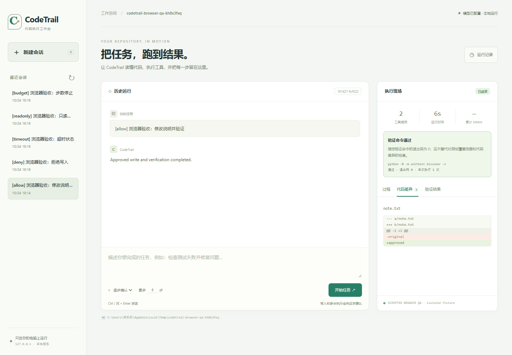

# CodeTrail · 代码执行工作台

面向本地代码仓库的 Agent Harness 与网页工作台。把读取代码、执行工具、审批修改、运行测试和查看结果放在同一条可追踪的执行流程中。



## 真实 Tabbit 网页集成测试（2026-10-25）

通过已打开的 Tabbit 真实点击、输入、逐项审批和结果回放，在硅基流动 `deepseek-ai/DeepSeek-V4.1-Flash` 与 AppContainer 后端完成三类冻结修复任务：单文件、跨文件、未知位置定位。三个全新工作区均通过独立验收，每题 8/8 条测试；测试文件未修改。额外验证连接恢复和审批拒绝，**不计入历史 Benchmark 成功率**。

修复状态轮询一次断连后永久停止的问题，增加有限退避重试；Tabbit 重做相同断连后自动恢复原审批。全量自动化 **309/309 通过**。保留三次多工具包协议拒绝、首轮失败测试及截图工具超时。[完整测试报告与证据](benchmarks/results/tabbit-e2e-2026-10-25/report.md)包含真实截图、逐运行 CSV、独立验收、代码差异、隔离审计、原始浏览器 receipt 和复现命令。

## 可靠性与Windows隔离更新

新增[Recall诊断与AppContainer说明](docs/reliability-v2.md)，保持下方历史评测和金标原样。Recall@5主结果仍为53.21%；余额未中断的描述性切片为81.55%，同时发现4题将可修改范围误标为必要证据。未修改金标、未事后重算一个替代高分，也未声称检索性能提高。

Windows可选择 **AppContainer测试执行**：过滤工作区副本、独立标准库、无网络能力、Job进程/内存/输出/超时限制，失败不回退宿主。相同14个守卫在新后端通过14/14；旧13/14失败保留。受测宿主文件读写被拒、本地网络投递被阻断；外网出口与内核漏洞未评估，不能宣称完整VM沙箱。通用CLI/网页的host兼容模式仍无OS隔离，界面明确标注。

普通评测入口已补齐余额/鉴权故障停止派发；原生工具增加真实参数范围和剩余步数提示，最后一步保留验证。没有新增模型评测，协议/Recall/成本改善尚未验证。

专用Demo默认隔离执行：`python -X utf8 scripts/run_final_demo.py`。全量自动化回归 **308/308通过**；完整新证据见[本轮报告](benchmarks/results/reliability-v2-2026-10-25/report.md)。

## 最终七维评测（2026-10-25）

本轮冻结 **30道不同任务：原20道＋新10道真实开源故障**，原计划每题3次、90次。硅基流动实际模型ID为 `deepseek-ai/DeepSeek-V4.1-Flash`，使用原生Tool Calling，Thinking与输出分别请求4096 Token，工具20步、并发3，协议与金标在正式调用前冻结。

首批90次已全部记录并独立重测：**功能与流程均为36/90（40.00%）**，其中原题20/60、留出16/30；另外54次因平台HTTP402余额不足中断。替换凭据后的追加恢复单独记录，首批失败不覆盖。不得将余额中断解释为模型修复能力，也不得从总体分母删除。

| 批次 | 原20题功能/流程 | 新10题功能/流程 | 全部功能/流程 |
|---|---|---|---|
| 首批90次 | 20/60 | 16/30 | 36/90（40.00%） |
| 凭据恢复追加54次 | 40/40 | 13/14 | 53/54（98.15%） |
| 实际全部144次 | 60/100 | 29/44 | 89/144（61.81%） |

**全部144次包含54条余额失败和1条真实修复失败，不将追加覆盖成一次90/90实验。** 真实失败是连续空格解析题：错误补丁、5次拒绝调用与分页读取耗尽20步，最后修改后未重测。没有放宽权限或重跑掩盖。

过程共904个工具步、114次多工具包协议拒绝，重复读取0/355；这些是不同口径。独立安全守卫13/14，真实模型README攻击6/6；保留获批代码读取本地假canary的隔离缺口。Windows真实IO专项捕获短时WinError5并有限重试恢复；实际费用未获可归因账单。

- **[最终工程报告](benchmarks/results/final-agent-90-2026-10-25/final-report.md)**、[凭据恢复报告](benchmarks/results/final-agent-90-2026-10-25/credential-recovery-report.md)、[全部执行CSV](benchmarks/results/final-agent-90-2026-10-25/all-executions.csv)、[逐题首批→追加分布](benchmarks/results/final-agent-90-2026-10-25/per-task-with-recovery.csv)。
- [完整证据包](benchmarks/results/final-agent-90-2026-10-25/evidence.zip)、[SHA256](benchmarks/results/final-agent-90-2026-10-25/evidence.sha256)与[公开复现命令](docs/final-agent-reproduction.md)。参考补丁不发布，公开重跑不依赖私有金标。
- [首批完整报告](benchmarks/results/final-agent-90-2026-10-25/report.md)与[七维指标定义](benchmarks/results/final-agent-90-2026-10-25/methodology.md)：结果、检索上下文、证据忠实性、工具过程、稳定恢复、成本效率、安全权限。
- [架构图](docs/final-agent-architecture.md)与[面试讲解](docs/final-agent-interview.md)：独立外部验收、冻结金标、过程监控、Windows有限重试、失败保留和安全边界。
- 全量自动化测试 **292/292通过**；测试用例数与Agent任务数分开统计。任务数量有限，旧20道已用于历史评测，其中6道参与额外调优；新10道只保证此前未用于本项目Agent调优，无法保证模型训练未见。
- 安全独立统计。应用层拒绝越界、敏感路径、未经批准的Shell和测试修改；**批准的Python仍以当前用户运行，没有OS沙箱**。真实费用、广义语义忠实性及真实任务长期记忆收益没有可靠观测时标为未评估。

本轮真实修复的离线回放（不调用API，不增加任务数）：

```powershell
python -X utf8 scripts/replay_repair_demo.py --run artifacts/final-agent-90-2026-10-25/runs/01-dependency_order-r1 --destination artifacts/your-demo-replay
```

原始轨迹可从最终证据包解压到项目根目录。运行本地网页Demo前，在本地进程环境设置 `SILICONFLOW_API_KEY`；随后执行：

```powershell
python -X utf8 scripts/run_final_demo.py
```

该入口只读取环境凭据，不加载旧 `.env`，固定硅基流动模型，保留交互审批。故障任务见 `examples/final-eval-demo/README.md`，初始验收故意失败；实际正式评测由独立控制器执行，网页操作不计入评测指标。

## 能力

- **Agent 循环**：模型请求、工具调用、结果回传与最终回答。
- **上下文管理**：分层组织历史、记忆与当前任务，按预算裁剪。
- **轻量记忆检索**：tag、关键词与中文双字片段召回；文件摘要使用内容哈希检查新鲜度。
- **操作治理**：参数和路径校验、写操作与命令审批、只读模式、重复调用拦截及日志脱敏。
- **过程可视化**：工具事件、文本差异、命令退出码、历史运行与会话继续。
- **结果判定**：区分模型回答结束、验证通过、验证失败和需要重测。

网页使用 Python 标准库 HTTP 服务与原生 HTML/CSS/JavaScript，无前端构建依赖。服务只绑定本机。

## 快速开始

需要 Python 3.10 或更高版本。在项目根目录执行：

```powershell
python -m venv .venv
.venv\Scripts\Activate.ps1
python -m pip install -e .
Copy-Item .env.example .env
```

在本地 `.env` 中填入模型服务的 API Key。通用示例使用硅基流动DeepSeek V4.1 Flash的Chat Completions接口；本轮评测与专用Demo仅从环境变量读Key；Key不需要填写到网页中，也不应提交到仓库。

```dotenv
PICO_PROVIDER=openai
PICO_OPENAI_API_BASE=https://api.siliconflow.cn/v1
PICO_OPENAI_API_FORMAT=chat_completions
PICO_OPENAI_MODEL=deepseek-ai/DeepSeek-V4.1-Flash
PICO_OPENAI_API_KEY=填写自己的Key
PICO_MAX_NEW_TOKENS=4096
```

启动工作台：

```powershell
python -X utf8 -m pico.web --cwd examples/interview-demo --model-timeout 180 --open
```

Windows 也可以双击 `start-web.cmd`。默认网址为 **http://127.0.0.1:8765/**。修改 `.env` 后需要重启服务。

选择“逐步确认”，输入任务；写入文件或执行命令前会显示审批卡片。运行结束后，结合代码差异、测试输出和退出码检查结果。具体用法见[网页指南](docs/local-web-workbench.md)。

### 终端入口

```powershell
codetrail --cwd examples/interview-demo --approval ask --max-new-tokens 8192
codetrail-web --cwd examples/interview-demo --model-timeout 180
```

未安装命令入口时，可使用 `python -m pico` 和 `python -m pico.web`。底层 Python 包名、`PICO_*` 环境变量与 `.pico/` 数据目录保留兼容性。

## 修复示例

| 示例 | 内容 | 验收 |
| --- | --- | --- |
| `examples/interview-demo` | 商品数量、折扣、运费与输入校验 | 订单 12 项，加法 3 项 |
| `examples/repair-demo-pagination_boundaries` | 分页起点、末页、向上取整与非法输入 | 8 项 |
| `examples/repair-demo-user_lookup_contract` | 跨文件参数顺序、ID 规范化与查询契约 | 8 项 |

订单示例保留已完成的修复结果。重复演示前运行：

```powershell
python examples/interview-demo/demo.py reset
```

它会备份当前实现，再恢复故意设置的缺陷。其他两个示例保留故障起点；任务要求见各自 README。

## 验证与证据

新增 **20 个独立修复任务 × 每题3次** 的冻结评测协议，覆盖单文件逻辑5题、跨文件契约7题、未知位置定位4题、回归与兼容4题；其中8题来自两个真实开源项目的故障最小复现。题目、验收测试、统一参数、运行计划及源码哈希在模型运行前冻结，详见[评测协议与复现](docs/repair-suite-v1-protocol.md)。

60次真实运行已全部完成并独立重测，未筛选或替换失败记录。模型为 `zai-org/GLM-5.3-Flash`：

| 来源 | 独立任务 | 运行次数 | 功能验收 | 完整流程 |
|---|---:|---:|---:|---:|
| 全部 | 20 | 60 | **43/60（71.67%）** | **42/60（70.00%）** |
| 自编题（含此前两题） | 12 | 36 | 34/36 | 34/36 |
| 真实上游故障最小复现 | 8 | 24 | 9/24 | 8/24 |

失败包括15次请求读取超时、1次无代码变更、1次修复不完整，以及1次外部测试通过但Agent未重测。平均工具调用6.95次，平均执行及外部验收139.071秒；可观测输入/输出Token为977528/294946，15次超时请求的用量未知。工作区内未授权最终变更为0；本轮不是对抗安全测试。

详见[最终报告](benchmarks/results/repair-suite-v1-2026-10-24/report.md)、[完整审计JSON](benchmarks/results/repair-suite-v1-2026-10-24/audit.json)与[失败案例分析](docs/repair-suite-v1-failure-analysis.md)。[完整证据包](benchmarks/results/repair-suite-v1-2026-10-24/evidence.zip)包含60次完整Prompt/可见模型回复、未裁剪工具输出、session/trace、代码差异、测试和哈希清单；解压到项目根目录即可离线核对或回放。

本轮Harness及评测设施的全量自动化测试 **225项全部通过**，见[JUnit记录](benchmarks/results/repair-suite-v1-2026-10-24/full-tests.xml)。这些测试不计为独立Agent任务。公开故障、可见测试和小型复现不能代表复杂仓库泛化能力，60次重复也不等于60个独立任务。

可运行的上游故障 Demo：

```powershell
python -X utf8 -m pico.web --cwd examples/repair-suite-demo --model-timeout 180 --open
```

任务提示在示例 README 中，初始测试故意失败。使用 `scripts/prepare_suite_demo.py` 可从20道冻结题中另建全新示例目录；不包含参考补丁。

固定回归、受控消融和真实模型任务分开报告，不把单元测试数量当作独立任务数量。

### 运行问题修复

修复了普通进度文字被当作最终回答的问题。CLI、网页和恢复会话可通过 `--verify-command` 指定验收命令：最近一次修改后没有真实退出码0时，Harness拒绝结束并要求继续修复；预算耗尽或验证被拒绝时保留未完成状态。命令仍需正常审批，测试通过本身不保证测试覆盖充分。

OpenAI兼容接口增加读取超时、断连、限流等有限重试及逐次传输审计。每个逻辑请求最多3次尝试，重试前检查2倍配置超时的预算；socket超时不是严格墙钟截止时间。失败请求的Token保持未知。网页默认单次等待180秒，外部服务持续超时仍会失败。

```powershell
python -m pico --cwd path/to/project --verify-command "python -m pytest -q"
python scripts/check_repair_baseline.py
```

原始60次评测及证据包保持原样。当前运行时代码已升级，旧 `run_repair_suite.py --check` 应在原始证据包解压的独立目录或原始提交中执行；上面的资产检查器验证当前金标和归档内的原始运行时代码。修复后的定向回归单独记录，不能替换原始总体成功率。

本次全量软件测试 **242/242通过**。另外冻结6道已知问题题目、每题2次的真实回归，独立重测结果为功能与完整流程均 **5/12（41.67%）**，7次因接口读取超时失败；1次在传输失败后重试并完成。库存与UTC契约两题各2/2通过，splitlines为1/2，另外三题各0/2。本轮未触发最终回答拦截事件，门槛机制的行为由软件测试验证，不能归因于真实成功率变化。详见[修复说明](docs/recovery-fixes.md)、[单独回归报告](benchmarks/results/repair-regression-v2-2026-10-24/report.md)、[独立审计](benchmarks/results/repair-regression-v2-2026-10-24/audit.json)和[完整证据包](benchmarks/results/repair-regression-v2-2026-10-24/evidence.zip)。

### API超时诊断

另用25次HTTP诊断区分输入长度、并发、开始输出前的等待与生成阶段耗时，不执行Agent工具，也不计入修复成功率。128/8192/32768字符的固定输出请求在串行和三路并发下18/18完成；真实失败提示词的流式重放显示，开始思考较快，可见答案却可能长期不出现。`max_tokens`不包含硅基流动的思考Token，socket等待与重试预算也不是严格总时限。没有服务端队列日志，不能据此宣称完全排除后台负载或并发影响。

详见[分段计时与结论](benchmarks/results/api-timeout-diagnosis-2026-10-25/report.md)、[完整诊断数据](benchmarks/results/api-timeout-diagnosis-2026-10-25/summary.json)及[原始证据包](benchmarks/results/api-timeout-diagnosis-2026-10-25/evidence.zip)。本次只新增诊断与本地超时复现，生产模型参数及既有冻结评测均未改变。

随后单独测试DeepSeek官方V4.1 Flash：同一提示词的7次HTTP对照均完成，约1.0–3.4秒。真实任务分三轮，各6题×2次：旧Anthropic非思考适配1/12，DSML转换后2/12，Chat Completions默认思考/high和8192总输出预算4/12；三轮均无传输失败，原始失败全部保留。更快的响应没有直接解决修复正确率，仍存在混合文本协议、重复读取和实现修复不完整的问题。

此前示例改为官方Chat Completions，并对官方DeepSeek域名兼容一个完整DSML工具调用；该阶段仍有协议混用和上下文截断问题。网页可用 `PICO_MAX_NEW_TOKENS` 或 `--max-new-tokens` 设置包含思考的总输出预算。详见[官方接口测试与局限](benchmarks/results/deepseek-official-2026-10-25/report.md)、[全部36次独立重测](benchmarks/results/deepseek-official-2026-10-25/audit.json)和[完整证据包](benchmarks/results/deepseek-official-2026-10-25/evidence.zip)。旧批次应使用其归档源码和对应后端的本地凭据配置，不应直接套用当前模型配置。

本次适配后的全量软件测试 **267/267通过**，见[JUnit记录](benchmarks/results/deepseek-official-2026-10-25/full-tests.xml)。软件测试通过不代表真实模型任务全部修复成功。

### DeepSeek 协议与修复循环治理

对以上36次轨迹逐条离线分析，发现旧 Thinking 轮有31次格式重试、145次实际文件读取中的35次同参数同输出重复读取，以及91次读取的部分源码行未进入下一轮有效请求。最近工具结果曾被历史渲染压到900字符；前两轮还出现DSML结束标记进入补丁内容。旧请求没有原生 `tools`，因此不能把它们的失败直接归因于缺少 `reasoning_content` 回传。

当前官方 DeepSeek Chat Completions 使用原生 function tool_calls；回传实际 assistant 的 content、tool_calls 与内存中的 reasoning_content，再以真实 tool_call_id 提交工具结果。文本工具协议不作为回退执行通道。长文件读取明确返回未读范围，原生会话保留工具反馈，补丁拒绝明确提示未写入及精确重试方法。路径隔离、写入审批、重复调用拦截和最后一次修改后验收门禁均保留；其他模型接口继续使用原兼容协议。

本轮沿用 **6道独立冻结题 × 每题2次，共12次运行**，不是12道独立题。复用原 Thinking 轮计划、题目、测试和模型/工具预算；协议、上下文交付及反馈是组合修复，不能将效果分别归因于某一个改动。详见[受控复测与根因报告](benchmarks/results/deepseek-controlled-2026-10-25/report.md)、[独立审计及逐次指标](benchmarks/results/deepseek-controlled-2026-10-25/audit.json)和[完整可见证据](benchmarks/results/deepseek-controlled-2026-10-25/evidence.zip)。思考正文只在运行内存中回传，审计保留长度和哈希；冻结源代码与参数可重跑，无法逐字重放历史思考正文，也不保证服务端随机输出一致。

全量自动化测试 **280/280通过**。相同计划的独立复验结果：功能验收和完整流程均 **11/12（91.67%）**，旧 Thinking 轮均为4/12；平均工具步数17.17→9.58，同参数同输出的重复读取35→0。输入/输出可观测Token为601600/50060，失败运行的完整性标记保留为false。12次协议重试均为多调用包被拒绝，24次未批准的shell命令尝试被拦截，未授权最终变更为0。唯一失败为Windows原子替换状态文件时的 `WinError 5`，未单独补跑；额外100次不调用模型的状态文件替换探测复现了1次同类错误，具体占用者未确定，该持久化健壮性问题仍待处理。不能将本轮结果描述为零协议错误、零失败或复杂仓库泛化能力。

此前的独立验证批次（不并入上述60次）：

- 订单演示：真实模型修复后 15/15 测试通过，独立重测通过，测试文件未修改。
- 两类新增修复任务，各运行两次：原始四次中功能验收 3/4、完整流程 2/4；参数反馈改进后的 1 次定向回归单独记录。
- 实际 Tabbit 浏览器完成 17 项检查，覆盖审批、刷新恢复、历史、错误状态及桌面／窄屏布局。交互使用隔离的脚本模型后端；真实模型修复另行验证。

这些是小规模工程验证，不代表复杂仓库的普遍修复成功率。

- [评测口径](docs/evaluation-scope.md)
- [真实修复与回归记录](docs/repair-validation.md)
- [失败分析](docs/failure-analysis.md)
- [网页验收](docs/workbench-browser-acceptance.md)
- [运行架构](docs/architecture/agent-harness-v1-overview.md)

本地执行相关自动化测试：

```powershell
python -m pip install pytest
$env:PYTEST_DISABLE_PLUGIN_AUTOLOAD='1'
python -X utf8 -m pytest tests -q -p no:cacheprovider
```

真实模型实验脚本会调用自己的模型接口；固定单元与集成回归使用预设响应。Key和私人会话不随源码发布。本轮固定公开题的运行证据经过凭据扫描后单独打包，原始本地目录仍被Git忽略。

## 使用范围

这是本地单用户工具。命令审批与路径限制不等同于操作系统级沙箱，应在可信的示例或工作区中使用。记忆检索采用透明的词法规则，没有 Embedding、通用语义冲突消解或完整的记忆提示词注入防护。

## 来源与改进

CodeTrail 基于 [Pico](https://gitee.com/htxoffical/pico) 二次开发，保留其 Agent Harness 核心。新增和完善的内容包括本地网页工作台、硅基流动 Chat Completions 适配、中文词法召回、Windows 执行兼容、执行结果判定、可重复修复案例和运行证据整理。详见 [来源说明](UPSTREAM_NOTICE.md)。
