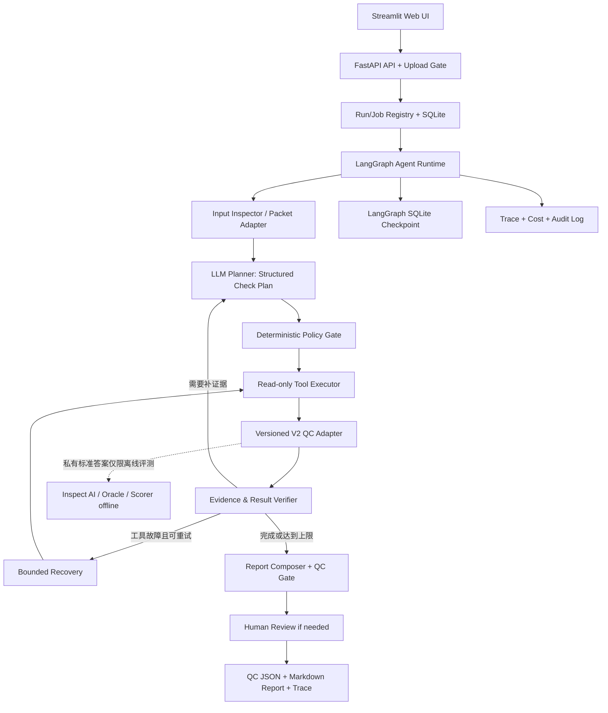

# AssemblyGenomics-Copilot V3｜GenomeQC Agent 总控开发计划

> **文档角色**：V3 的唯一总控入口（Master Development Plan / Agent Engineering Specification）。供 Codex、开发者和验收使用；**不是“已经实现”声明**。  
> **制定日期**：2026-10-17 ｜ **最近增量更新**：2026-10-17（v2.1.1 基线，见文末 Change Log）  
> **目标岗位**：Agent 开发工程师、AI 应用工程师、AI for Science / 生信 Agent 工程  
> **版本**：Plan v1.1（v1.0 → v1.1 最小增量；章节与任务安排不变）  
> **产品名**：GenomeQC Agent（AssemblyGenomics-Copilot V3）  
> **总体原则**：V2 保持冻结、V3 独立开发；**规则负责事实，LLM 负责规划与解释，人对高风险处置保有审批权**。

---

## 0. 总决策：现在启动 V3，V2 收尾后再升级依赖

**采纳“双轨并行 + 两阶段集成”。**

1. **现在**：以现有 V2 最终验收报告为**工程能力索引**，审计 V2 实际源码，在独立 V3 工作区开发真正面向用户的 GenomeQC Agent（MVP）。
2. **V2 Release 继续**：V2 的 Git 收尾、来源组审计、Rubric 作者复核、E1/E2 收据整理、Gitee S1/S2，由原 V2 任务处理，不阻塞 V3 的设计、Mock 实现与离线测试。
3. **V2 正式 Release 后**：切换 V3 的 `v2_adapter` 基线到明确的 V2 release tag/commit，做兼容性和回归验证，必要时做一次**受控的 V3 依赖升级**；不覆盖旧版本、旧基准或旧运行收据。
4. **禁止**：直接在 V2 的冻结目录中做 V3 开发、在 V3 运行时加载私有 Oracle 金标、未经批准调用付费模型、为了“Agent 化”重写已有可靠的 QC 规则。

### 0.1 首要资料及读取顺序

**本机权威入口**（要求 Codex 读取，不能只凭本计划推断实现）：

```text
D:\1_yanjiusheng\AssemblyGenomics-Copilot_V2\bench\organelle_v2\docs\V2_FINAL_ACCEPTANCE.md
D:\1_yanjiusheng\AssemblyGenomics-Copilot_V2\V2_STABLE_HANDOFF_REPORT.md   # v2.1.1 稳定交接（2026-10-17）
D:\1_yanjiusheng\AssemblyGenomics-Copilot_V2\STATE.md                      # V2 终态一句话入口
D:\1_yanjiusheng\AssemblyGenomics-Copilot_V2\RELEASE_CHECKLIST.md          # 发布清单（含 §H 交接增量）
```

然后读取（若存在）：

```text
V2 仓库 README.md / STATE.md / RELEASE_CHECKLIST.md
bench/organelle_v2/README.md
bench/organelle_v2/inspect_integration/
bench/organelle_v2/recovery/
bench/organelle_v2/normalize/
bench/organelle_v2/oracle/
bench/organelle_v2/rubric/
bench/organelle_v2/tests/
```

> **真实性规则**：当前总控的 V2 数值基于使用者提供的 2026-10-17 Final Acceptance 文本。编写总控时未直接读取该 Windows 本地路径或当前源码。Codex 必须在本机逐项核验**确切模块路径、可导入符号、数据结构、最新提交和可复用许可**，输出 `V2_ASSET_AUDIT.md`；报告仅证明曾通过验收，不是函数接口说明。

### 0.2 现有 V2 资产基线（v2.1.1 @ commit 7518adc，2026-10-17 实测核验）

**基线更新说明**：V2 已从 v2.0.0（108912e）演进到 **v2.1.1 稳定交接（tag v2.1.1，commit 7518adc）**：P0-1 服务器完整性 PASS、P0-2 Rubric 审核身份勘误+用户盲评 40/40 闭环、P0-3 全域 1220 口径绑定、P1-1 Gitee Mock 端到端闭环；测试基线 **522 passed + 18 skipped**。V3 快照源文件在 v2.0.0→v2.1.1 区间 **diff = 0**（快照继续有效）。详见 `V2_STABLE_HANDOFF_REPORT.md`（§5 公共 API 清单、§6 不可继承模块）与 V3 侧 `docs/V2_ASSET_AUDIT.md`。

| 能力 | Final Acceptance / Handoff 所报告事实 | V3 计划用途 |
|---|---|---|
| 双域任务库 | 线粒体 M1 984、叶绿体 C1 236，共 1,220 道自动 verified 任务（评测池 128 + 生产池 1092，6/6 字节绑定） | 离线测试、回归及后续受控模型比较；**不是用户任务的答案库** |
| Inspect AI / recovery | `original / computed / computed_located / computed_verified / computed_verified_sf` | 保留为**离线评测器**；不直接把 Inspect Solver 当 Web Runtime |
| 数据解析 | GenBank / 标准化公开证据包 | 复用确定性的输入转换、特征计数与结构化解析 |
| 只读证据工具 | 如 `organelle_summary` 及受限文件/统计工具 | 通过独立适配层封装成 Agent 可调用的受限工具 |
| Oracle / Scorer | 独立 Oracle、verdict/root cause/证据锚定/critical failure | 开发与测试侧离线使用；不可暴露私有标准答案给 Agent |
| Trace / 审计 | 运行收据、指针核验、有界纠错和错误归因 | V3 另建真实用户任务的操作轨迹与结构化审计，引用规则与实现模式 |
| 模型 | `glm-5.3-flash` 与 `deepseek-v4.1-flash`（Qwen/Hy4 停用留证） | 通过配置化 Model Gateway 接入；具体 provider 参数需核对 |
| 自动化质量 | v2.1.1 基线 **522 passed + 18 skipped**；服务器完整性收据 PASS | 作为历史验收记录，不能替代 V3 测试 |
| 传输层合同 | `validate_plan / export_results_whitelist / verify_incoming_bundle`（fail-closed，§5 清单） | G6 升级时评估封装为 V3 计划校验参照；当前快照不引入 |

### 0.3 工作区及隔离策略（重要）

推荐：

```text
D:\1_yanjiusheng\AssemblyGenomics-Copilot_V2\   # V2，原收尾任务，旧实验只读
D:\1_yanjiusheng\AssemblyGenomics-Copilot_V3\   # V3，全新独立工作区
```

- V2 若尚有未提交文件，不要从脏工作树随意 `git init`、`git clean` 或自动打 release tag；先由 V2 任务整理和保护。
- V3 起步时可使用**只读、可校验的 V2 公共工具代码快照**，记录 `source_commit`（若有）、代码文件 SHA256、`V2_FINAL_ACCEPTANCE.md` 文档哈希、依赖清单与导出时间；不得复制 `.env`、密钥、私有 `expected`、私有 `rubric`、原始模型完整日志到公开仓库。
- 如果已有稳定、干净的 V2 Git 提交，优先从该提交构建只读代码依赖；如果没有，则 V3 先以独立的 `v2_adapter` 接口及 Mock 工作，允许随后接入 V2 发布的稳定接口。
- 任何人不得让 V3 的开发操作修改 V2 原始冻结数据、批准文件、`RESULTS/TRACES` 和旧版文档历史。

---

## 1. 产品定位、真实 Agent 边界与 MVP

### 1.1 一句话产品定义

**GenomeQC Agent：面向细胞器基因组的交互式质量检查智能体。用户提供 GenBank 或标准化证据包及检查需求，Agent 基于当前证据动态选择只读工具，执行生信质控、定位异常、核验证据，并生成可复核的 QC 决策报告。**

- **不是**又一个自动造题器 / Benchmark 网站。
- **不是**把所有工具固定按顺序运行后由大模型总结的“伪 Agent”。
- **不是**会修改 FASTA/GenBank 的自主修复机器人。
- **不是**已实现自主 SFT/DPO/权重更新的 Self-Evolving Model。
- **是**一个 *workflow-first、Agent-assisted* 的有状态领域工具调用应用。

### 1.2 初版输入与范围

MVP 接受：

1. **单份 GenBank/GBFF**：只能报告从该记录及转换出的公开证据中确实可以验证的注释、坐标、结构、翻译/序列一致性等检查；**单文件不能凭空验证缺失的跨文件对应关系**。
2. **V2 标准化的公开 QC packet**：若包含 FAA/GFF/TSV/FASTA 等多文件，才开放跨文件 ID、成员集合、数量一致性等检查；依数据合同判断哪些工具适用。
3. `domain ∈ {vertebrate_mitochondrion, chloroplast, auto_detect_supported}`；超出范围明确拒收或标注 unsupported，不假装可检查完整核基因组。

输出：`pass / warn / block / insufficient_evidence`（与 V2 公共合同对齐，必要时适配映射）；规则标识、对应文件/feature ID/坐标、证据指针、适用范围、未检项、整改建议、运行与工具消耗统计，以及标明模型生成的自然语言解释。

### 1.3 真正的 Agent 条件（MVP 必须展示）

- **根据输入与工具结果选择下一步**：至少 2 条有意义的、可复现的不同工具路径，而不是无条件遍历。
- **工具驱动事实**：LLM 不凭自由文本计算专业数值；所有决定性事实来自只读工具和确定性核验。
- **有状态执行**：运行状态持久化，按 `run_id/thread_id` 查询；中断可显式恢复（不会因恢复重复产生不允许的副作用）。
- **有界恢复**：工具异常、格式问题、证据缺失触发有限重试/回退或要求人工查看，不无限循环。
- **可观察**：每一步 tool call、参数（脱敏）、结果摘要、依据、分支选择、版本、费用/请求计数可追踪。
- **人机边界**：`block` 是审核建议而非自动执行删除/修改；必要时 `needs_human_review`。

### 1.4 明确不做（MVP 范围外）

多 Agent 群聊、自由 Shell 执行、通用文件系统访问、自动下载任意 URL、自主修改原始生物学数据、长期向量记忆、Kubernetes 微服务、SFT/DPO/QLoRA、持续无人监管策略发布、全量运行 1,220 题付费评测。MCP 可在后续通过现有工具适配层增补，不是 MVP 的必要前提。

---

## 2. 技术选型（工程决定）

| 层级 | 选型 | 原因 / 约束 | MVP 状态 |
|---|---|---|---|
| 主要语言 | **Python 3.11** | 与新 Agent 生态兼容，避免复用旧 `c1r` Python 3.9 环境 | 必选 |
| Agent 编排 | **LangGraph `StateGraph`** | 显式图节点、条件路由、工具回环、中断与 Checkpointer；比不可控自由循环容易审计 | 必选 |
| 模型适配 | **OpenAI-compatible SDK `openai` + `httpx` + 自建 Provider Adapter** | GLM/DeepSeek 配置化接入；隔离不同供应商的 thinking / reasoning / tool-call 参数 | 必选 |
| 数据合同 | **Pydantic v2** | 任务请求、工具输入/输出、运行状态、报告 Schema 与严格验证 | 必选 |
| 后端 API | **FastAPI + Uvicorn** | 提交任务、状态查询、审批/恢复和报告接口，自动生成 OpenAPI 文档 | 必选 |
| Agent 状态持久化 | **LangGraph `langgraph-checkpoint-sqlite` + SQLite** | MVP 单机持久化和按 thread 恢复；异步接口使用 `AsyncSqliteSaver`，而不是同步 Saver 的 async 方法 | 必选 |
| 应用业务账本 | **SQLite + SQLAlchemy 2.x**（或清晰隔离的 `sqlite3`） | 存 run/job、工具步骤摘要、对象路径、审核/成本账本；与 LangGraph checkpoint 分表/分库 | 必选 |
| 前端 | **Streamlit**（调用 FastAPI，而非直接绕过 API） | MVP 快速完成上传、运行轨迹、报告页；之后可换 React/TypeScript | 必选 |
| 测试与质量 | **pytest / pytest-asyncio / httpx AsyncClient / Ruff** | Mock LLM、Mock 失败、契约测试、API 测试、V2 兼容回归 | 必选 |
| 打包 | **`pyproject.toml` + 锁定依赖版本**，Docker 可选 | 独立安装、可复现、避免污染 V2 Conda 环境 | 必选 / 可选 |
| 任务调度 | **单机受控 Worker**，初期不引入 Redis | SQLite 持久化排队状态，应用启动检查遗留运行；单进程、有限并发；长任务不依赖单独的 FastAPI `BackgroundTasks` 来保证持久交付 | 必选 |
| 分布式队列 | Redis + RQ/Celery | 真正多进程生产/服务器后才引入；不是第一版必需 | 可选 |
| 可观测 | JSONL 日志 + Python logging + V2-compatible trace exporter | 全链路 request/run/tool/version 追踪；脱敏与成本统计 | 必选 |
| CI | GitHub Actions（如仓库可用）或本地 CI 脚本 | 运行离线测试、secret 扫描、lint | 推荐 |

**依赖版本策略**：创建独立 `v3` 虚拟环境，在实际 Windows/服务器验证兼容后锁定准确版本和哈希；不要在总控里猜测当前“最新”小版本，也不要盲目复用 V2 的 Inspect/c1r 环境。LangGraph 的 SQLite Saver 适合轻量本地用例，后续上线需评估 Postgres。FastAPI `BackgroundTasks` 不应替代需要可靠恢复的长运行任务队列。

参考技术文档：

- LangGraph Quickstart：https://docs.langchain.com/oss/python/langgraph/quickstart
- LangGraph persistence：https://docs.langchain.com/oss/python/langgraph/persistence
- LangGraph checkpoint-sqlite：https://reference.langchain.com/python/langgraph/checkpoint.sqlite
- FastAPI：https://fastapi.tiangolo.com/
- Pydantic：https://docs.pydantic.dev/latest/

---

## 3. 总体架构与职责分离



**职责底线**：

- `Planner`：根据用户意图与现有公开摘要提出**允许的工具调用**，返回结构化计划；不能凭自己预测确定生物结论。
- `Policy Gate`：检查参数 Schema、文件 allowlist、步骤上限、必要 QC 不得跳过、预算；拒绝越权计划。
- `Tool Executor`：调用确定性只读函数，结果按原样或规范化事实结构返回；不得自行更改判定真值。
- `Evidence Verifier`：检查文件/hash/field/feature/coordinate 指针是否存在，引用与支持性分开；不把合法定位当作语义支持充分。**v2.1.1 人工 Rubric 复核实证了这条纪律**：40 条真人盲评 vs AI 代理评分，证据支持维（es）精确一致仅 13/40，真人严格低于 AI 27 条、MAE 0.675——AI 系统性把"指针可定位"当作"证据完整支持"。V3 因此：`verify_evidence_pointer` 只回答指针可解析性；报告的证据充分性判定必须来自覆盖该结论的完整事实集合（如 statistics 全量 equal），不满足时给 `partial`/`insufficient_evidence`，且证据维判读不得交给未经真人校准的自动化流程。
- `Report Composer`：给出基于已验证事实的报告；缺乏证据时写 `insufficient_evidence`，不得写“全部正常”。
- `Offline Evaluator`：使用 V2 的私有 Oracle/Scorer 做测试，不在用户 Agent 的依赖图和环境变量路径中暴露私有答案。

---

## 4. Agent Graph 与状态机

### 4.1 初始图（不要把所有节点都交给 LLM）

```text
START
  -> intake_validate
  -> build_public_packet
  -> deterministic_mandatory_checks
  -> plan_next_action       [LLM + strict structured plan]
  -> policy_gate
      ├─ allowed: execute_tool -> verify_observation
      │             ├─ need_more_evidence -> plan_next_action
      │             ├─ retriable_error -> bounded_recovery -> execute_tool
      │             └─ sufficient / budget_reached -> synthesize_report
      └─ denied: record_violation -> replan_once_or_stop
  -> report_schema_validate
  -> optional_human_review
  -> persist_and_finish
END
```

- **Mandatory deterministic checks** 是底线；Agent 可以选择更深入的检查，但不能通过忽略必检项而获得 `pass`。
- `bounded_recovery` 仅对可重复的只读工具调用自动重试；遇到输入不合法、文件缺失、来源不支持，应中止或请求补充，不无限重试。
- 总图要有 `max_steps`、`max_tool_calls`、`max_retries_per_tool`、`wall_time_limit`、`max_llm_requests`、`max_model_tokens`、`max_cost` 配置；单次运行不能突破预算。
- 终止状态：`succeeded`、`needs_human_review`、`insufficient_evidence`、`failed`、`cancelled`、`budget_exhausted`；`paused` 与 `queued/running` 单独记录。

### 4.2 持久状态 Schema（逻辑合同，具体代码用 Pydantic/TypedDict 实现）

```yaml
run_id: UUID
thread_id: UUID
input:
  packet_id: string
  domain: string
  user_goal: string
  manifest_sha256: string
runtime:
  status: queued|running|paused|succeeded|failed|cancelled|needs_human_review|budget_exhausted
  step: int
  plan_version: string
  model_id: string
  model_provider: string
  tool_contract_version: string
  v2_adapter_version: string
  checked_rule_ids: [string]
  observations: [public_fact_or_tool_receipt]
  findings: [finding_without_private_gold]
  retry_counters: {tool_name: integer}
  budgets: {model_requests: integer, tool_calls: integer, token_estimate: integer}
  checkpoint_ref: string
result:
  evidence_validity: valid|partial|invalid|not_applicable
  qc_decision: pass|warn|block|insufficient_evidence
  report_ref: string|null
```

状态只存结果引用与必要结构化摘要；GBFF、FASTA、长 Trace 存在任务隔离文件空间，不塞进 checkpoint。`thread_id = run_id`（首版一任务一线程），重启恢复必须通过 checkpoint + 幂等工具账本验证，不得因为重复提交而生成同名多任务。

---

## 5. V2 工具复用、V3 对外 Tool 合同

### 5.1 复用优先，不假定实际接口存在

| V3 对外工具（拟定义） | 目标功能 | V2 可能来源 | 实施方式 |
|---|---|---|---|
| `inspect_packet` | 列出输入文件、hash、支持范围、字段可用性 | `normalize/`、已有只读文件工具 | 优先封装旧函数 |
| `organelle_summary` | CDS/基因/坐标/结构计数、可用事实字段 | recovery 事实工具 | 精确复制**公开**字段合同，不泄漏 Oracle |
| `lookup_feature` | 给定 feature ID / 类型查询精确位置与注释 | normalize / 公共证据包 | 如果 V2 无完整 API，新增确定性只读适配 |
| `cross_file_consistency` | 检查 ID 集合、GFF-FAA 对应、坐标等 | V2 公共数据解析、独立规则 | 仅在所需文件齐备时可调用 |
| `verify_evidence_pointer` | 校验文件/field/feature 指针及事实来源 | V2 evidence pointer 校验 | 验证存在性，与语义支持性区分 |
| `summarize_findings` | 对已验证检查结果做机器可读汇总 | 新建合并器 | 不含金标；非 LLM 事实计算 |

MVP 至少接入 3 个**实际可用**的受限领域工具，覆盖 2 条不同执行路径。原 V2 的 `inspect_integration` / `recovery` 函数如果耦合 Inspect AI 私有上下文，应拆出纯函数适配层，**不要直接把整套 Inspect Runner 嵌入 FastAPI**。

### 5.2 Tool 安全合同

- `ToolRequest` 必须经 Pydantic 严格校验，不接受任意 `command`、外部 URL、无限制 glob、文件绝对路径或路径穿越。
- 每个 `run_id` 有独立只读 packet 根目录；输入上传先验证扩展名、实际文件类型、大小、解压限制、路径、符号链接、编码；解压时防 zip-slip/压缩炸弹。
- 上传只能写入**隔离 staging**；证据正式进入工具只读视图前记录内容 SHA256；V3 不覆盖 V2 文件。
- Tool 输出中原始基因注释文本/用户自述均视为**不可信数据**，不得执行里面的提示或命令（prompt injection）。
- 输出错误要有机器可读的 `error_code`、`retryable`、`reason`；不得把内部路径、堆栈或供应商密钥返回到 UI。
- 模型 API 不应有任何私有 `expected.json`、Gold Rubric 或测试 split 标记；V2 评测单独在 trusted evaluator process 中完成。
- 版本记录：`tool_name / tool_version / input_schema_hash / code_sha / packet_sha / trace_id`。

---

## 6. 模型适配、成本与授权

- **正式两个模型**：GLM、DeepSeek；默认只为它们实现 `ModelGateway`。读取 V2 报告记录的具体 `model_id`，避免用模糊品牌名伪装精确对照。
- Provider Adapter 层负责处理不同的 JSON/Tool Calling、thinking/reasoning、消息结构、超时和 finish reason，不允许 GLM 特定 `extra_body` 泄漏到 DeepSeek。V2 既有 provider 泄漏故障应变成 V3 回归测试。
- 区分 LLM 规划调用、LLM 报告生成调用和工具调用；请求、实际/估算 token、延迟和错误分别计账。
- **离线阶段全部使用 FakeModel/RecordedModel**，先通过至少三条路径的断言；正式 GLM/DeepSeek 网络调用单独写 run 计划、模型参数、上限和授权。
- V2 的本地/服务器 `SESSION_CAPS` 是 V2 已有 run 的账本，**V3 必须新建预算账本，不得继承或挪用 V2 剩余额度**。
- 供应商 429 应遵守有效 Retry-After/退避节奏，网络故障受熔断和幂等策略约束；只读 Tool Retry 不等于可随意重复付费模型请求。

---

## 7. API、前端与报告合同

### 7.1 最小 FastAPI 接口

| Method | Endpoint | 行为 |
|---|---|---|
| `POST` | `/api/v1/jobs` | 提交目标与 input packet（或独立 upload 完成后的 packet_id）；返回 `202 + run_id` |
| `POST` | `/api/v1/packets` | 上传/登记公开数据包，验证文件安全、类型和 SHA256 |
| `GET` | `/api/v1/jobs/{run_id}` | 状态、当前节点、最近安全事件及版本 |
| `GET` | `/api/v1/jobs/{run_id}/events` | 经脱敏、分页的 Tool Trace；可后续升级 SSE |
| `GET` | `/api/v1/jobs/{run_id}/report` | 结构化 QC JSON 和可阅读 Markdown |
| `POST` | `/api/v1/jobs/{run_id}/resume` | 显式恢复已暂停/可恢复任务；状态与权限检查 |
| `POST` | `/api/v1/jobs/{run_id}/cancel` | 幂等取消；运行节点按取消标记安全停机 |
| `GET` | `/healthz` | liveness；ready 检测应另外提供或分清语义 |

真实 API 必须防越权访问、限制上传大小和速率。MVP 本地单用户演示可设置只监听 `127.0.0.1`；如公开部署，**必须增加身份认证/授权、HTTPS、数据保留策略和隔离**，不可把本地版直接暴露公网。

### 7.2 Streamlit 最小页面

1. **New QC Job**：上传 GenBank/packet、领域、目标、模型、预算上限（预算只可往更严格方向收紧）。
2. **Agent Execution**：按时间展示 planner 决策、工具调用、错误、重试和运行状态。
3. **QC Report**：处置建议、每条 finding 的 rule/evidence、适用检查/未检项、原始公开证据定位、token/调用和错误摘要。
4. **History / Resume**：展示已有任务和失败恢复入口；仅操作本人有权访问的任务。
5. **Examples**：3 个固定公开演示包（正常、故障、证据不足），清楚注明示例/真实模型或 Mock。

### 7.3 Report 数据合同

```json
{
  "run_id": "UUID",
  "input_sha256": "...",
  "domain": "vertebrate_mitochondrion",
  "model_id": "provider-exact-id",
  "qc_decision": "warn",
  "findings": [
    {
      "check_id": "cross_file_protein_id",
      "status": "warn",
      "summary": "示例：ID 集合存在差异（非真实结果）",
      "evidence_refs": ["packet://features.tsv#feature=..."],
      "verification": "verified_by_tool"
    }
  ],
  "not_checked": ["optional external comparison"],
  "needs_human_review": false,
  "trace_ref": "...",
  "versions": {
    "agent": "v3-mvp",
    "v2_adapter": "snapshot-id",
    "tool_contract": "1",
    "prompt": "1"
  }
}
```

**说明**：上述 JSON 完全是格式示意。字段含义、枚举和受支持的证据指针须与 V2 的事实合同核实后冻结。示例证据引用不等于现成可用的指针语法。

---

## 8. 推荐项目目录（允许 Codex 适配实际仓库）

```text
AssemblyGenomics-Copilot_V3/
├── V3_MASTER_PLAN.md                      # 本文件
├── README.md
├── pyproject.toml / uv.lock               # 精确可复现依赖；若环境用 pip 也可锁 requirements
├── .env.example                           # 仅变量名和安全示例，无真实凭据
├── src/genomeqc_agent/
│   ├── config.py
│   ├── schemas/                            # Pydantic API/Tool/State/Report 合同
│   ├── runtime/
│   │   ├── graph.py                       # LangGraph StateGraph
│   │   ├── state.py
│   │   ├── routing.py
│   │   ├── recovery.py
│   │   ├── checkpoint.py
│   │   └── policy.py
│   ├── model/
│   │   ├── gateway.py
│   │   ├── glm.py
│   │   ├── deepseek.py
│   │   └── fake_model.py
│   ├── tools/
│   │   ├── registry.py
│   │   ├── inspect_packet.py
│   │   ├── organelle_summary.py
│   │   ├── lookup_feature.py
│   │   ├── cross_file_consistency.py
│   │   └── verify_evidence.py
│   ├── adapters/
│   │   ├── v2_adapter.py                  # 只读、版本化接入 V2 公共工具
│   │   └── packet_adapter.py
│   ├── jobs/                               # Job registry / worker / idempotency
│   ├── audit/                              # 结构化 Trace、版本、成本与脱敏
│   ├── reports/                            # 报告结构与 Markdown 输出
│   ├── api/main.py                         # FastAPI routes
│   └── storage/                            # Packet store、SQLite 数据访问
├── ui/streamlit_app.py
├── examples/public_packets/                # 许可允许的脱敏公开演示材料
├── tests/
│   ├── unit/
│   ├── contract/
│   ├── security/
│   ├── integration/
│   └── e2e/
├── docs/
│   ├── V2_ASSET_AUDIT.md
│   ├── V3_ARCHITECTURE.md
│   ├── TOOL_CONTRACTS.md
│   ├── EVAL_PROTOCOL.md
│   ├── V2_TO_V3_UPGRADE_REPORT.md
│   └── V3_ACCEPTANCE.md
└── scripts/
    ├── smoke_offline.py
    └── export_safe_demo.py
```

路径与模块名字是建议，不要求无差别创建全部空目录。**按验证通过的最小可运行路径逐步实现**，杜绝“很多模块文件但没有真实端到端功能”。

---

## 9. 分阶段执行计划与质量闸门

| 阶段 | 优先级 | 工作 | 验收闸门 |
|---|---|---|---|
| **G0 基线隔离与资产审计** | 必须先做 | 读取 `V2_FINAL_ACCEPTANCE.md` 和仓库、核对公开模块、创建 V3 独立目录与快照 | `V2_ASSET_AUDIT.md`、依赖/来源哈希；V2 工作树和历史收据完全未变 |
| **G1 Tool Adapter + 离线 QC** | 必须 | 复用/封装 >=3 种只读工具，严格 Tool Schema 与输入安全 | 三个公开案例的确定性工具证据可核查；伪造路径和越权文件全部拒绝 |
| **G2 LangGraph Runtime** | 必须 | 动态条件路由、有界恢复、checkpoint、分支轨迹、Mock Provider | 至少两种真实不同工具路由；中断/恢复、预算耗尽和不可恢复错误测试通过 |
| **G3 API + UI** | 必须 | FastAPI job 生命周期、Streamlit 展示、SQLite 状态与报告 | 用户可以上传数据→执行→查询轨迹→导出 QC 报告，无手工改源码 |
| **G4 模型受控验证** | 必须（真实 Agent 展示） | 两模型的小样本端到端实测、统计成本、失败示范 | Mock 全绿；若获 API 授权，GLM/DS 的确切运行收据和安全失败均留痕 |
| **G5 与 V2 Benchmark 的对接** | 推荐 | 用公共 packet 作 V3 输入、私有 Oracle 在隔离评测进程评分 | `EVAL_PROTOCOL.md`、来源级划分核验、可复现对照；未见组结论按实际声明 |
| **G6 V2 Release 后升级** | 必须（正式 V3 release 前） | `v2_adapter` 基线改为 V2 stable tag；全量兼容、旧用例回归、报表对账 | 新旧 Adapter 配对一致（或差异有解释）、安全回归通过、升级/回滚记录齐全 |

**先后依赖**：G0→G1→G2→G3；G4 可在离线 G2/G3 稳定后批准；G5 不必阻断功能 Demo；G6 待 V2 Release 之后执行。

### 9.1 MVP 验收用例与最低证明

**场景集（建议至少 12 个、覆盖两个域和不同来源组）**：

- 正常（正确报告无异常，不能凭一个统计字段证明所有一致性）；
- 明确故障（如真实公开 packet 的 ID 不匹配、越界等，能定位到正确证据）；
- 证据不足（缺 FAA 时不推断成员集合一致，给 `insufficient_evidence` 或未检项）；
- 工具失败（超时、429/网络错误、错误参数、路径不存在，有界处理）；
- 恶意输入（目录穿越、提示注入、文件白名单外访问、恶意归档）；
- 服务重启后 `resume` 与重复提交的幂等性。

至少提交：

1. **3 个可复现完整 Demo**：正常、故障、恢复/证据不足；Demo 指明 FakeModel 或 GLM/DS 实际输出。
2. 至少 2 条通过行为轨迹证实的不同工具路径（包含决策原因与当时已有证据）。
3. `0` 次未授权文件读取、`0` 次私有答案泄漏、`0` 次无界调用（安全测试必须全绿）。
4. 至少一次中断后按 `run_id` 恢复，不丢失已完成的任务事实/审计记录。
5. 至少一份 `QC_REPORT.json` + `.md`，每个核心判断都可回溯到公开工具证据；`not_checked` 如实列出。
6. FastAPI OpenAPI 可打开，Streamlit 页面实际调用 API，不在 UI 中放直接模型密钥。
7. 真实模型阶段（若批准）报告模型精确 ID、分母、成功、失败、假阳性/假阴性、工具选择、成本、时延和完整收据。**不预填准确率、延迟或改善百分点。**

---

## 10. V2→V3 二阶段依赖升级（用户本轮特定策略）

### 阶段 A：先按 2026-10-17 验收快照开发

- 在 G0 做 `V2_ASSET_AUDIT.md`，记录“验收文档内容”和“可运行源码证据”两列。
- 为 `V2Port` 写明确的 Protocol 接口，业务层只依赖 `V2Port` 而不是任意调用 V2 内部模块；若源码缺口则先提供严格区分的 Mock，并记录 TODO。
- 与 V2 历史目录隔离；阶段 A 的 `v2_adapter_version` = `v2-acceptance-snapshot:<hash>`。
- 只输出 V3 自己的运行收据，不能假称运行的是最终 V2 release。

### 阶段 B：V2 Release 全部收口后再升级

**触发条件**：V2 已有正式 Git tag + 对应 commit、清理秘密与未提交内容、发行/冻结清单和已知限制说明。Rubric 作者审核若后续补齐，仅影响 V3 **评测可信度**，不应迫使业务 Agent 依赖评分器私有逻辑。

**升级标准步骤**：

1. 锁定当前 V3 commit、快照/适配器版本及通过的离线测试；保留可回退 tag。
2. 对照 V2 Release 清单确认接口/合同 diff；导入**公开的**纯规则模块和公共证据读取层；不得导入私有标准答案。
3. 对固定公开用例分别运行旧 Adapter / 新 Adapter，比较文件/hash/关键事实/异常码/字段 Schema；分歧必须逐条审计。
4. 完成 Tool 安全测试、状态恢复测试、Agent 报告验证测试，以及 V2 兼容回归；必要时生成新版 `adapter_contract_version`。
5. 若新版本失败，回滚 V3 的依赖 pin/适配器，不动 V2 Release；不得直接覆盖旧 V3 运行记录。
6. 通过后记录 `V2_TO_V3_UPGRADE_REPORT.md`（变更、验证、受影响用例、回滚命令、最终新旧 hash）。

**特别提醒**：V2 release 收尾产生的 Rubric/A/B 新结论可以更新 V3 的评测文档，但不应偷偷调整用户 Agent 的 Prompt 或工具，避免把历史实验混成不可比较的版本。

---

## 11. 测试、审计与发布纪律

- `pytest` 分层运行：unit→contract→security→integration→end-to-end→真实模型 smoke（最后一类需授权）；Mock 禁止真实 API 网络访问。
- 所有代码变更包含最小测试，失败要可复现，不以“现场看起来正常”替代。
- 运行记录：`run_id / git_commit / input_sha / model_exact_id / tool_contract_sha / prompt_version / budget / trace / report_sha / outcome`。
- 原始模型错误、超时、中断、模型不兼容都应保留原始分母；对用户界面可以友好展示，但不粉饰评分。
- 测试数据按 `source_group_id` 隔离，复用已被看过的 DEV/test 样本不冒充新的严格盲测。
- 不公开任何 API key、付费访问令牌、私有标准答案、未许可生信数据、V2 完整私有原始日志。
- 不允许 V3 的“修复”反向更新 V2 冻结 Oracle 或消除旧版失败收据。
- CI 包括 secret scan、依赖锁检查、lint、类型/Schema、测试、安全反例；非必要不引入第三方云服务。

### 11.1 关键验收产物

```text
V2_ASSET_AUDIT.md
V3_ARCHITECTURE.md
TOOL_CONTRACTS.md
EVAL_PROTOCOL.md
V3_ACCEPTANCE.md
V2_TO_V3_UPGRADE_REPORT.md (阶段 B 才产生)
README.md + 实际运行命令 + API schema + 3 份脱敏演示报告
```

---

## 12. Codex 总控执行纪律与第一轮指令

### 12.1 无条件规则

1. **先审计后编码**：读取 `V2_FINAL_ACCEPTANCE.md`，检查源码及依赖，不得仅凭总控推断 API。
2. **不阻塞**：V3 G0–G3 不必等 V2 Rubric 全部复核、E2 或 Gitee S2 完成；G5/G6 依赖的正式验收另说。
3. **最小闭环**：每轮优先交付端到端可运行的小功能，而不是开设大量尚未运行的模块。
4. **预算隔离**：默认 Offline Mock；调用 GLM/DeepSeek 前另行请求模型、任务数和成本上限授权。
5. **版本诚信**：所有输出标明 `implemented/tested/pending`，不把文档计划写成已实施。
6. **版本与分母**：不改 V2 真值、收据；同一 V3 功能对照保留精确版本和错误分母。
7. **每轮 Codex 输出**：实际修改文件、运行命令、通过/跳过/失败测试、风险、下一可执行动作。

### 12.2 第一轮直接发给 Codex 的任务

```text
你负责启动 AssemblyGenomics-Copilot V3 / GenomeQC Agent。

总控文件：V3_MASTER_PLAN.md。
首先阅读：
D:\1_yanjiusheng\AssemblyGenomics-Copilot_V2\bench\organelle_v2\docs\V2_FINAL_ACCEPTANCE.md
然后逐项检查 V2 源码与已有测试，不得将验收报告当作 API 文档。

用户决定：V3 现在开始，V2 Release 由另一任务继续收尾。
V3 与 V2 必须隔离。V2 发布后再做 V3 Adapter 升级。

本轮只执行 G0 + G1 的最小实现：
A. 建立独立 V3 工作区和本总控文件，不碰 V2 冻结数据。
B. 生成 V2_ASSET_AUDIT.md：真实可用函数/路径、许可证/依赖、可适配工具合同、版本与 SHA。
C. 建立 Python 3.11 虚拟环境，选择兼容的 LangGraph/FastAPI/Pydantic/SQLite/checkpoint 版本并锁定。
D. 编写 V2Port、Packet/Tool/Report 的 Pydantic Schema。
E. 接入至少一个真实 V2 公开只读工具，补 Mock Provider 和测试；验证安全拒绝非法路径。
F. 给出一个“公开输入→工具事实→结构化 QC finding”的离线 smoke。

禁止真实付费 API、禁止开发第三模型、禁止修改 V2 Oracle 或旧收据。

本轮完成时汇报：
实际文件变更、可运行命令、测试结果、源代码复用表、尚缺接口以及进入 G2 的阻塞项。
```

---

## 13. 里程碑看板模板（更新进度不得虚构）

| 阶段 | 状态 | 完成证据 | 阻塞 |
|---|---|---|---|
| G0 资产隔离与审计 | **DONE (2026-10-17)** | `docs/V2_ASSET_AUDIT.md`（深化版：测试基础设施盘点、隔离矩阵、git 教训、v2.1.1 基线复核）；快照 10 文件 SHA256 锚定，V2 工作树零改动 | — |
| G1 只读工具与离线 QC | **DONE (2026-10-17)** | 4 个只读工具 + ToolRegistry + PacketFiles 沙箱 + composer；48 passed + ruff clean；故障包→block 带证据、伪造路径全拒绝 | — |
| G2 LangGraph Runtime | **DONE (2026-10-17)** | `runtime/graph.py` StateGraph（§4.1 节点全覆盖）+ SQLite checkpointer + ScriptedPlanner（FakeModel 契约）+ policy gate + bounded recovery；59 passed + ruff clean；两条真实工具路由实证（fault→verify-only，synthetic multipart→lookup_feature）；中断/恢复（interrupt_before + resume 循环，报告与不间断运行逐字节一致）；预算耗尽终态、必检项不可跳过、持久性故障有界停止均测试通过 | — |
| G3 API + UI | **DONE (2026-10-17)** | `api/main.py`（§7.1 全部 7 端点 + 列表扩展）+ `storage/ledger.py`（SQLAlchemy 业务账本，与 checkpoint 分库）+ `jobs/worker.py`（单 worker 线程 + 取消语义）+ `ui/streamlit_app.py`（§7.2 五页面，仅走 HTTP）；71 passed + ruff clean；真实 uvicorn HTTP 全链路实证（上传 GBFF→提交→轨迹 10 节点→Markdown 报告导出），Streamlit 无头启动 200 | G4 需 API 授权 |
| G4 双模型小样本真实验证 | **DONE (2026-10-18，双模型完成)** | 收据 `docs/G4_GLM_RECEIPT.md` + `docs/G4_DEEPSEEK_RECEIPT.md`：**chloro 40 全量双模型对标——GLM-5.3-Flash 40/40 graded（2 轮 repair）、DeepSeek-V4.1-Flash 40/40 graded（0 repair）；判定一致率 40/40**；tokens GLM≈188.8k + DS≈215.0k，成本留空；5 类安全失败真实留痕；93 passed + ruff clean（CI 无网络） | — |
| G5 V2 Benchmark 集成 | **DONE (2026-10-17，DEV 切片)** | `EVAL_PROTOCOL.md` + `eval/adapter.py`（含不可映射跳过）+ 隔离 grader worker（V2 venv 解释器）+ 静态/数据隔离守卫；86 passed + ruff clean；首轮 8 案例 chloro DEV 切片 **8/8 graded、judgment 8 pass**（ScriptedPlanner、单域、非 LLM、非 held-out——按 §5 分母纪律如实声明）；看板遗留的两类负测试（私有值不泄漏公开字节、task.md 跨任务类型一致性）已补齐 | — |
| G6 V2 Release 依赖升级 | **DONE (2026-10-18)** | `docs/V2_TO_V3_UPGRADE_REPORT.md`：基线 `v2-acceptance-snapshot:00e3424` → **`v2.1.1-snapshot:7518adc`**（tag v2.1.1）；快照源 00e3424→7518adc diff=0，manifest 重导出全部对齐；新旧 adapter 8 案例配对判定完全一致；93 passed + ruff clean；回滚路径成文。历史收据零覆盖 | — |

**总控最终交付目标**：用户不看底层代码即可提交 QC 数据包，Agent 自主选择受限工具、核验发现、有限恢复并输出带证据报告；实际性能由独立的 V2 验证体系证明。此时才可在简历中准确写出 **LangGraph Agent Runtime + Tool Calling + FastAPI + Checkpoint + Evidence-Grounded QC + Inspect AI Evaluation**。

---

## 14. Change Log（总控文件自身变更记录；章节与任务安排保持稳定）

### v1.1（2026-10-17，最小增量更新——按 V2 v2.1.1 稳定交接状态）

依据：实测核验 V2 仓库 tag `v2.1.1`（commit `7518adc`，工作树干净），并非仅凭交接报告推断。变更点：

1. **§0.1 首要资料**：新增三份 V2 参考文档入口——`V2_STABLE_HANDOFF_REPORT.md`、`STATE.md`、`RELEASE_CHECKLIST.md`。
2. **§0.2 资产基线**：更新为 v2.1.1 @ `7518adc`——P0-1/P0-2/P0-3/P1-1 全 DONE；测试基线 510→517→**522 passed + 18 skipped**；评测池 128 + 生产池 1092 = 1220 任务经 POOL_BINDING 6/6 字节绑定；新增"传输层合同"行（`validate_plan` 等 fail-closed API 列入 G6 评估，当前快照不引入）。V2 快照源文件在 v2.0.0→v2.1.1 区间 **diff=0**，既有快照与 manifest 继续有效。
3. **§3 Evidence Verifier 职责**：纳入 v2.1.1 人工 Rubric 复核（40 条真人盲评）核心发现——**证据指针有效 ≠ 证据充分支持结论**（es 维人机一致 13/40、AI 系统性宽松 MAE 0.675）。落实为：指针工具只回答可解析性；报告证据充分性必须来自覆盖该结论的完整事实集合；不满足给 `partial`/`insufficient_evidence`；证据维判读不得交给未经真人校准的自动化流程。
4. **§13 里程碑看板**：按实际完成证据刷新——G0/G1 **DONE**（V2_ASSET_AUDIT.md 深化版；48 passed + ruff clean；故障包→block 带证据）；G2 **IN_PROGRESS**；G6 状态 BASELINE_READY（v2.1.1 tag 已存在，升级执行待 G2–G3 稳定）。
5. **未变更**：§2 技术栈（LangGraph、FastAPI、Pydantic v2、SQLite/checkpoint-sqlite、Streamlit、GLM/DeepSeek 双模型）全部保留；§0.3 隔离策略（V3 独立工作目录、不改 V2 冻结资产）不变；§0.1/§12.1 "先审计后编码、检查实际代码接口"规则不变；§6/§12.1 未经授权禁止调用付费模型 API 的纪律不变。
