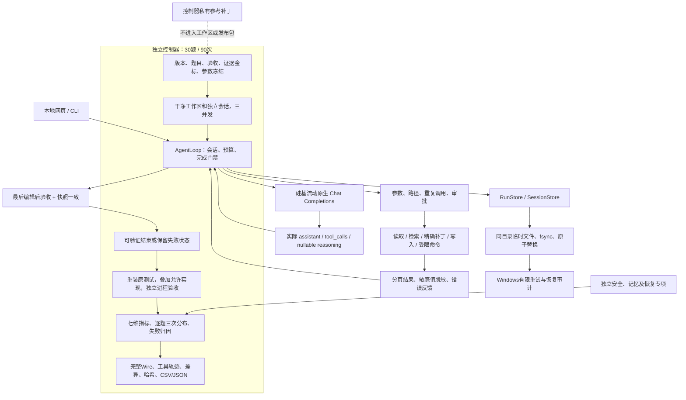

# CodeTrail：运行、治理与评测架构

运行时复用现有工具注册和执行路径；硅基流动DeepSeek适配只在已核实的域名和模型ID启用。每次真实评测新建客户端、工作区和会话。普通工作台不默认导出思考正文；本轮公开任务评测按授权记录第三方API完整请求/响应体，Authorization不记录。

状态持久化最多尝试5次，等待25/50/100/200ms，只对已知Windows权限/共享异常有限重试。每次失败与最终恢复/耗尽均审计；不删旧目标、不改ACL、不无限重试，耗尽临时文件保留。持久化重试不等于Agent任务重跑。

检索证据与最终答案分开验收：检索金标是预先定义的故障源码邻域与跨文件契约片段，最终正确性由原测试的独立复验决定。低读取次数本身不能证明高召回。当前原生会话保留工具结果；长期记忆模块存在，但本轮新会话评测不据此声称长期记忆有效性提高。

安全边界是应用层。文件工具拒绝越界、敏感路径，命令和写入继续审批；测试子进程移除环境凭据。但是已获批准的Python源码+测试仍以当前用户运行，可以绕过文件工具策略读取本机文件。独立安全集明确测试并披露该边界；生产级对抗隔离还需要进程/容器、文件系统与网络策略，当前项目不具备这项保证。

静态资产与动态环境分离：冻结源代码/题目不能冻结远端模型权重、服务器排队或硬件负载。只报告观测到的阶段与使用量，未知值保持未评估。持续回归使用新的批次目录，不覆盖历史失败；用于后续调优的留出题必须降级为开发题。

首批90次发生54次HTTP402后，用户提供替换凭据。追加控制器只选择全部余额中断槽位，先记录恢复协议和原始哈希，再按原顺序用原冻结worker执行；每次是新会话，原90次不覆盖。报告将90次、追加54次及全部144次分别列出，不将恢复包装成无中断的90次实验。

## 历史评测后的v2隔离路径

以上描述对应历史评测；v2新增可选Windows AppContainer验证后端，见[边界和证据](reliability-v2.md)。宿主工具审批→过滤快照→一次性AppContainer/标准库→Job限额/内核令牌核验→独立执行→只返回测试输出→回收配置。API Key不进入进程，工作区不直接挂载；失败不回退。通用host路径仍无OS隔离，不能把历史144次表述为在沙箱内执行。
