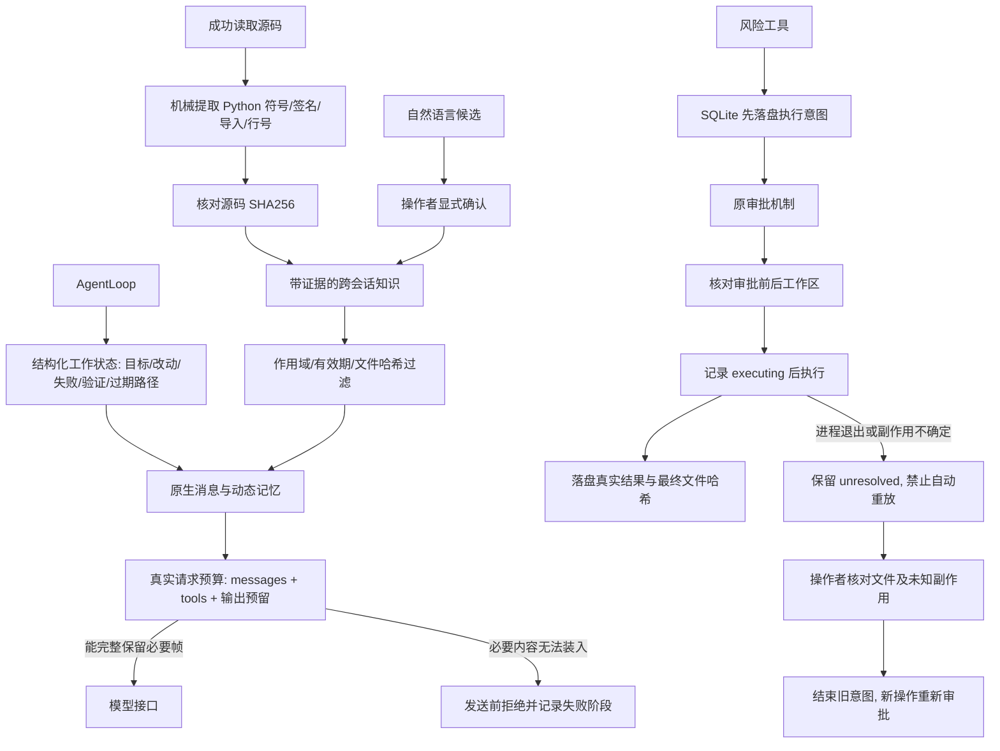

# 长任务治理实施记录（2026-11-04）

本轮目标：真实原生请求预算治理、带证据的记忆生命周期、风险工具的持久化执行与中断核对。

历史 30 题、全部运行与冻结金标保持原样。本轮先进行不调用远端模型的机制专项和全量软件回归，不用其结果改写历史成功率。

实现约束：

1. 在客户端真正发送的原生 messages/tools 上计算预算。无服务商 tokenizer 时使用明确标识的 UTF-8 保守估计，与真实 usage 分开；保存完整工具调用配对和所需 reasoning 字段。无法保留必要内容时拒绝请求，不静默切掉用户约束。
2. 任务工作记忆与跨会话仓库知识分开。候选信息不作为已验证事实召回；长期记录需要来源、版本、有效期和撤销/替换状态。自动写入只允许从源码机械验证的结构事实，模型总结不能自行升级为事实。
3. 风险调用先落盘 intent，再获得原审批并核对工作区，执行前记录状态，完成后保存文件哈希与结果。崩溃时不自动重放 Shell 或复用审批；不确定操作必须显式核对。保留原工具权限和验证门禁。

## 已实现的链路



### 实际原生请求治理

此前 `ContextManager` 生成的普通文本 prompt 与真正发送的原生 messages 是两条路径。本轮在客户端组装完模型参数之后、创建 HTTP 请求之前执行 `NativeContextBudget.prepare()`，计量包含工具 schema、消息、reasoning 字段与生成参数的序列化请求。轨迹记录处理前后估计量、请求 SHA256、压缩组数、记忆是否被预算剔除；输入/输出真实 usage 仍取服务商响应，未知值不填零。

默认 input budget 为 32768、accounting window 为 65536，可通过 CLI 或网页服务的 `--native-input-budget`、`--native-context-window` 配置。计量方式明确标为 **UTF-8 JSON 字节的保守估计**，不是服务商 tokenizer 的精确 Token 数，也不是服务商公布的上下文窗口。输出预留考虑 `max_tokens`；硅基流动另有 `thinking_budget` 时一起预留。真实效果仍需要在固定配置的远端实验中验证。

压缩只移除完整的旧 assistant/tool_calls/tool 结果组，保留最新一组及其真实 ID、所需 reasoning 字段。原始用户请求、系统指令、运行预算、任务验证状态不裁剪；动态记忆预算不足时整体省略，不把半条知识伪装成完整事实。旧输出保留工具名、目标、哈希和有限预览；完整结果仍在会话/运行工件中，不保证预览包含完整 traceback，必要时重新读取源码或经审批重跑测试。

新任务不再直接拼入整个旧工具原始 transcript。它携带既有用户指令及结构化历史状态，旧测试通过不作为本轮验证；源码变化通过失效路径提示与新检索处理。用户指令本身过长时仍会发送前拒绝，当前没有自动语义合并用户约束的能力。

### 记忆生命周期

- 工作状态保存在 session，记录当前目标、已修改文件、最近失败及验证结果；不自动当作长期知识。
- 仓库知识保存在 `.pico/memory/knowledge.sqlite3`，绑定工作区身份；数据库拷到其他仓库时拒绝使用。
- 支持 `repository` 和 `session` 两种作用域。记录包含 ID、fact key、版本、证据文件 SHA256、创建时间、可选 TTL、确认来源及状态。
- 自然语言通过 `candidate → 操作者确认 → active`；没有确认的候选不进入新知识召回。源码结构可以在 AST 机械复验一致后激活，但它只是结构索引，**不是理解了函数全部业务语义**。
- 相同 fact key 的新版本激活会将旧记录标为 `superseded`，并以事务和乐观版本检查防止覆盖。文件变化/TTL 到期分别标为 `stale`/`expired`；可显式 `retracted`，不会恢复被替换的旧值。
- 旧 Markdown durable memory 保持兼容，原生消息中明确标为未验证旧笔记；它不升级为新知识系统的已验证记录。新增的、绑定源码的会话笔记也按文件哈希过滤过期内容。

不承诺语义冲突自动识别：不同 fact key 的相互矛盾自然语言尚需人工处理。没有跨用户共享知识或多租户授权；仓库级记忆也不能覆盖工具审批和权限。检索仍是词法规则，本轮不宣称 Recall 或真实任务记忆收益提升。

### 中断恢复的准确含义

`OperationJournal` 为风险操作记录 `awaiting_approval → executing → completed`。命令超时等未知副作用记录为 `uncertain`。文件执行效果已产生、结果尚未记录时进程死亡，会保留 `executing`；新实例允许读取现场，但会拒绝新风险执行，直到操作者明确核对并结束旧意图。等待审批期间文件发生变化，也会使这次批准失效。

原生 call ID、run ID、参数哈希绑定具体操作；仅同一 ID、同参数且最终工作区哈希仍匹配时，可以返回已经落盘的结果，而不重新执行。新的运行不复用旧审批。SQLite 提供单库内事务，本机制 **不提供跨文件/任意 Shell 外部副作用的 exactly-once**，也没有自动重建重启前的网页审批卡片或自动续跑旧模型循环。当前采取单工作区风险操作互斥和显式核对，不是分布式任务队列。

## 可运行的离线 Demo

无需 Key，不调用远端模型。输出目录必须全新：

```powershell
python -X utf8 scripts/demo_long_task.py --output artifacts/my-long-task-demo
```

它使用真实文件、SQLite、工具执行器及原生消息组装器，配合明确标识的脚本化模型帧，演示跨会话源码知识、候选确认、过期失效、压缩、故障保留和新审批。它是机制验证，不算新的独立修复题，不计入历史 30 题或模型成功率。

本次首轮运行 `artifacts/long-task-2026-11-04/demo` 的 12 项检查通过，API 调用为 0。合成请求预算演示为 **110589 → 15451 字节**，移除 15 个完整旧协议组，保留最新调用和原始用户约束。这不是 Token 降幅，也不是线上成本或效果提升。

## 操作者命令

候选、确认和撤销均是宿主操作，未加入 Agent 工具白名单：

```powershell
python -m pico.knowledge_cli --workspace path/to/repo propose --key test-command --text "本仓库使用固定测试命令" --evidence pyproject.toml --ttl 86400
python -m pico.knowledge_cli --workspace path/to/repo show <memory-id>
python -m pico.knowledge_cli --workspace path/to/repo confirm <memory-id> --version 1
python -m pico.knowledge_cli --workspace path/to/repo retract <memory-id> --version 2

python -m pico.operation_cli --workspace path/to/repo
# 核对真实文件和可能的外部副作用后，使用上一条返回的当前哈希：
python -m pico.operation_cli --workspace path/to/repo --abandon <operation-id> --inspected-hash <hash> --reason "已核对现场，结束旧操作且不重放"
```

运行机制测试与全部回归：

```powershell
python -m pytest tests/test_long_task_context.py tests/test_knowledge_lifecycle.py tests/test_operation_recovery.py -q
python -m pytest -q --junitxml=artifacts/your-new-long-task-tests.xml
```

本轮全量 **340/340 通过，失败/错误/跳过均 0**，耗时 803.37 秒。真实 provider 只读检查在第一请求收到 HTTP402 余额不足后停止，完成模型会话 0 次，原始失败保留。详细记录、源码哈希和证据包见 [本轮报告](../validation/long-task-2026-11-04/report.md)；历史评测结果不因此改变。
