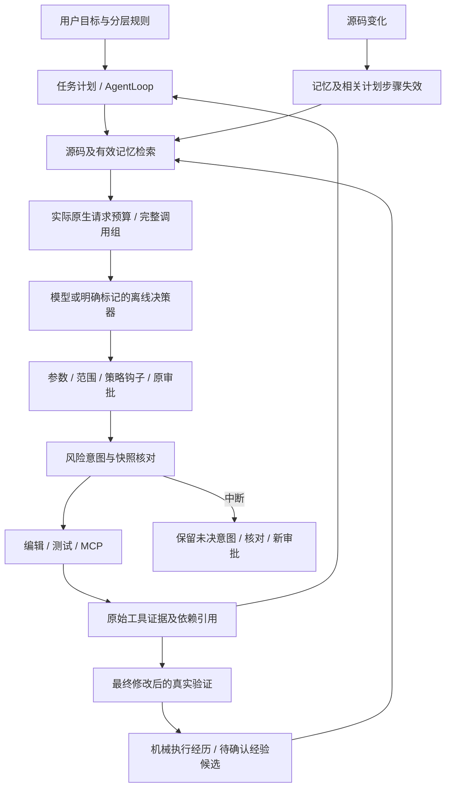

# 小规模完整工作台

2026-11-04。实现目标是让本地代码 Agent 的主要工程能力连成可检查的流程。保留 `classic` 兼容配置供历史实验复现，新增 `workbench` 配置启用完整能力；不把本项目称为 Claude Code、Codex 或 DSH 的等价替代品。

## 运行演示

Windows 推荐先用离线模式，无 Key、无模型 API 费用：

```powershell
python -X utf8 scripts/run_workbench_demo.py --offline --open
```

访问 `http://127.0.0.1:8770/`，默认 20 个工具步和逐项确认。输入示例：

> 修复用户标识规范化的空格与 Unicode 问题，先定位跨文件契约，只修改 directory.py，保留验收测试，修复后重新验证并提议测试入口记忆。

页面和最终答复明确标记脚本化模型。工具、审批、文件修改、子进程 MCP、SQLite、AppContainer 和测试均为真实执行。它用于演示机制，不代表真实模型自主决策质量。

如果已有演示服务占用8770，新开一轮可加 `--port 0`，自动分配空闲端口并由 `--open` 打开。离线脚本针对一次新工作区的完整修复，重复演示应创建新的工作区。

每次启动创建新工作区；指定 `--output` 时目录必须不存在，不能覆盖历史记录。原始演示模板保持故障状态，复制件中完成修复。演示只有一个修复问题、8 条测试，不是 8 道独立修复任务。

服务中断后，可用相同目录重启，不重置文件：`python scripts/run_workbench_demo.py --offline --output 原目录 --reuse-workspace`。入口检查演示身份与验收文件哈希；网页自动发现中断任务并撤销旧审批，需要核对未决操作后重新审批。

真实模型模式只使用本地 `SILICONFLOW_API_KEY`：

```powershell
python -X utf8 scripts/run_workbench_demo.py --embedding siliconflow --network-route direct --open
```

该入口固定硅基流动 `deepseek-ai/DeepSeek-V4.1-Flash`、temperature=0.2、top_p=0.95、输出预算4096、Thinking预算4096。Embedding 为 `BAAI/bge-m3`。`--network-route direct` 是显式绕开本机环境代理的连接选择，TLS 证书仍正常校验，服务商和模型不变；代理正常时可以省略。

本轮直连实际 Embedding 请求返回 HTTP402，尚未获得在线向量或新的真实模型修复效果。不要把离线演示说成这两项已验证。

已有仓库也可使用完整配置：

```powershell
python -m pico.web --cwd path/to/repo --harness-profile workbench --verify-command "python -B -m unittest discover -v" --shell-backend appcontainer
python -m pico --cwd path/to/repo --harness-profile workbench --embedding siliconflow --network-route direct --approval ask
```

AppContainer 目前只支持 Windows、标准库 unittest 和上述精确命令；不支持任意 pytest/npm/安装依赖。其失败不回退 host。显式选择 `--shell-backend host` 时没有 OS 隔离。

## 功能范围

| 能力 | 本次实现 | 有意保留的边界 |
|---|---|---|
| 原生工具调用 | 完整配置一次最多8个调用，串行执行、逐项预算/审批、保留全部真实ID与结果；不足预算的调用明确不执行 | 不并行写入；兼容配置仍要求单调用 |
| Thinking / 流式反馈 | 原生 Chat Completions SSE 增量组装正文、工具参数和所需 reasoning；仅完整结束的调用可执行 | 隐藏思考不显示；参数流未结束不执行；连接/响应头等待取消仍受超时约束 |
| 分层规则 | 从工作区根到目标目录发现 AGENTS.md / AGENTS.override.md，记录来源和SHA，不静默截断规则 | 规则是行为指导，不能授予工具权限；不实现所有厂商配置格式 |
| 代码理解 | Python AST 函数、方法、类、观察到的调用名；路径/符号导航；其他语言文本分块 | 不是完整LSP/类型系统，动态调用关系未知 |
| 混合检索 | BM25、符号匹配、可配置真实Embedding、RRF融合、模型与内容版本隔离缓存、失效过滤 | 小规模精确余弦检索，无ANN集群；未配置模型显示词法模式；失败明确降级 |
| 任务计划 | 最多12步、依赖、验收描述、状态和证据ID；源码变化使相关完成步骤失效 | 普通步骤仍是带证据的模型声明；verification步骤额外要求当前快照的实际成功测试 |
| 长期记忆 | fact/preference/workflow/experience候选；显式确认/撤销、版本、TTL、来源失效；新知识先过滤再检索 | 不把任意自然语言当作已证实事实；旧Markdown不在完整配置中自动授信 |
| 执行经历 | 从真实通过的验证机械生成历史事实，关联命令、快照和证据ID | 历史通过不证明当前通过；不是自动推导出的通用修复秘诀 |
| 上下文恢复 | 保留完整调用配对，压缩摘要附证据ID；find_evidence / recall_evidence查询当前会话原始脱敏输出 | 原始证据有大小限制；计量仍是JSON字节保守估计，不冒充精确Token |
| 编辑与撤销 | 老编辑工具也接入变更记录；新增最多8文件预检、expected_sha256、单文件原子替换和冲突安全撤销 | 多文件不能跨进程崩溃全局原子；存在后续用户编辑时拒绝覆盖 |
| 取消与恢复 | 网页取消审批等待、模型请求及工具循环；宿主进程树和AppContainer Job可终止；任务视图落盘，重启作废旧审批，显式继续新运行 | 任意外部副作用没有exactly-once承诺；不确定操作必须核对，不自动重放 |
| 扩展接口 | 按需SKILL.md、有界只读委派、MCP stdio握手/工具发现/调用、工具前后置策略钩子 | 自带一个只读文档MCP；无插件市场、任意远程MCP或自动运行技能脚本 |
| 安全与成本 | 原审批、路径检查、只读策略；完整配置拒绝内部状态与硬链接读取；策略路径规范化、审批后复核；未知usage保留null | 单用户本地服务；不保证完整语义注入防护；实际账单费用未知 |

`workbench` 总共17类工具（含已有delegate；深度限制到达后不再提供delegate）。工具存在不代表默认允许执行，外部MCP同样经过风险操作审批。

## 状态与证据



- `.pico/evidence.sqlite3`：追加会话事实、可寻址工具输出、证据关系。新配置从事件恢复会话历史和计划投影，不重放工具副作用。Session JSON是便于读取的状态快照；风险操作另由事务日志治理。
- `.pico/memory/knowledge.sqlite3`：候选、版本、来源、状态及确认来源。
- `.pico/retrieval.sqlite3`：按模型空间和分块版本隔离的向量缓存。当前源码块每次刷新，删除/变化不会继续作为当前索引使用。
- `.pico/changes/`：修改前后内容、哈希、差异与应用/撤销状态。
- `.pico/operations.sqlite3`：执行意图、审批、执行和不确定结果；现有恢复核对机制沿用。
- `.pico/web/tasks/`：任务视图；服务重启后的running/waiting状态会转为中断，旧审批不能复用。
- `.pico/runs/`：每次运行的trace、状态与报告。网页执行与独立外验分开。

这些记录的职责分别明确，不声称对文件、SQLite与任意外部副作用提供一个跨系统原子事务。

## 操作约定

“计划与记忆”页可确认/撤销候选，并显示来源和失效状态。未决操作必须核对当前文件及可能的外部效果，填写核对结论后结束旧意图；界面不会声称未知操作成功，也不会重放它。

终端确认与撤销仍可用：

```powershell
python -m pico.knowledge_cli --workspace path/to/repo list
python -m pico.knowledge_cli --workspace path/to/repo confirm MEMORY_ID --version VERSION
python -m pico.knowledge_cli --workspace path/to/repo retract MEMORY_ID --version VERSION
python -m pico.operation_cli --workspace path/to/repo
```

仓库技能放在 `.codetrail/skills/<name>/SKILL.md`。只预载名称和简介，正文由load_skill按需读取；不执行嵌入脚本，也不提升授权。

宿主前置策略可写入 `.pico/policy.json`：

```json
{"deny_tools": ["mcp_docs"], "protected_paths": ["release", "test_directory.py"]}
```

`protected_paths` 禁止读取及写入，递归搜索、索引、MCP、记忆和证据查回都逐来源检查；AppContainer副本也应用相同读取过滤。只需防止测试被修改时使用 `read_only_paths`，演示目录已自动配置测试、说明文件等只读。路径按规范化后的目标检查，风险操作审批后复核策略。执行期间策略变化会结束当前模型循环，避免继续发送被撤销授权的旧上下文。该接口提供结构化策略和前后置审计，不是一个任意Shell Hook执行器；host模式的任意命令仍不具备OS访问隔离。

`feature_flags.memory=False` 禁止动态知识注入、候选写入和自动经验提升；`relevant_memory=False` 单独关闭相关记忆注入。必需的任务目标、验证状态和审计记录仍属于执行控制状态，不因此删除。索引返回的源SHA绑定原始字节，CRLF可以直接用于编辑预检。

## 检查与复现

```powershell
python -X utf8 scripts/check_workbench_scenario.py --output artifacts/new-workbench-check
python -m pytest tests/test_workbench_profile.py tests/test_hybrid_retrieval.py tests/test_workbench_web.py -q
python -m pytest -q --junitxml=artifacts/new-full-tests.xml
```

连续专项覆盖真实测试失败后修复、当前版本独立外验、候选确认、跨会话召回、源码与计划失效、真实子进程退出、阻止重放及显式核对。完整报告见[本轮验证记录](../validation/workbench-v2-2026-11-04/report.md)。历史冻结题目与全部运行不变。

接口依据：[硅基流动Embedding](https://api-docs.siliconflow.cn/docs/api/embeddings-post)、[Chat Completions](https://api-docs.siliconflow.cn/docs/api/chat-completions-post)、[MCP stdio 2025-06-18](https://modelcontextprotocol.io/specification/2025-06-18/basic/transports)。MCP adapter有意固定一个明确版本及子集，不暗示支持该协议全部功能。
